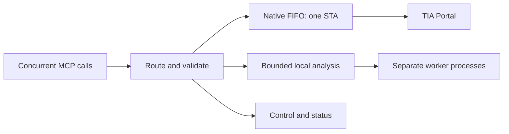

# Concurrent requests and native transactions

Host **0.13.0** accepts overlapping MCP requests on one connection. Pure local analysis runs in separate worker processes while native operations and transactions retain one owning STA thread. This is a host capability and requires an upgraded host/reconnect once. Worker reload alone cannot add it. The 51 MCP tools and their argument schemas are retained.

| Lane | Active limit | Waiting limit | Work |
| --- | ---: | ---: | --- |
| Native | 1 | 100 | Attach/version changes, native reads/exports, previews, applies, compile/save and reload |
| Local analysis | 2 by default | 32 | Advertised `local` read operations and disk-only classic bundle conversion |
| Control | 1 | 16 | Extension catalog/status and read-route classification |

Host 0.15.0 exposes these defaults through the desktop [Safeguards editor](SAFEGUARDS.md). Queue capacities, analysis parallelism and worker response deadlines apply on host restart; `--analysis-parallelism` explicitly overrides that saved parallelism. Native parallelism remains fixed at one.

Limits are per host. Queue capacity excludes active requests. Full queues return an error immediately; the host does not silently drop or replay requests. Invalid oversized extension arguments are rejected before queue admission. Existing per-request XML, frame and response bounds still apply; queue counts are not a shared memory-byte budget.



## Parallel analysis

Calls such as `inspect_xml`, `analyze_hmi_references`, `validate_hmi_bindings` and `reference_impact` can overlap. Each worker process handles one frame at a time; request/response streams are never shared by simultaneous operations. Local calls have their own lazily created pools and do not occupy the primary workers used by native workflows. Responses include the exact activated generation that produced their result.

The global local-analysis lane defaults to two jobs. To choose 1–8, add a server startup argument:

```powershell
& .\SiemensMCPServer.Mcp.exe --allow-writes --analysis-parallelism=4
```

This controls both the global analysis lane and each module's maximum local pool size. Workers are created on demand and reused; idle workers for previously used modules can remain loaded. Additional parallelism increases CPU and memory use. Primary workers remain separate. A faulted local worker is retired and replaced on a later call using the same activated bundle; it does not replay the failed operation or invalidate native previews. A primary worker failure still requires reload.

Native-capture read operations (`plcRead`, `projectRead`) keep their current capture/format workflow on the native lane. They do not become parallel native reads. Native results, including deferred enumerations, are serialized to immutable JSON on the owning STA before leaving the lane. No Siemens handles cross lanes. Direct file commands are independent processes and require distinct output directories.

## Transactions and conflicts

Multiple callers may submit transaction requests concurrently; one attached host dispatches them in native FIFO admission order. Every native call stays on the thread that owns the attached session. FIFO applies within a lane, after routing, rather than imposing a total order across all lanes.

Existing preview/apply guards remain in force: exact project/target, baseline fingerprints, candidate hashes, worker generation, plan expiry, Offline checks where required, Siemens exclusive access/transactions and readback. A later overlapping edit fails when its baseline is stale. Changes to separate objects can both succeed sequentially when their respective fingerprint scopes remain current. The host does not merge conflicting candidates automatically.

Each existing apply plan retains its transaction scope. Separate plans are not a single atomic multi-resource transaction. Nested or parallel native transactions within one attachment are not exposed. Compile and save remain separate operations. A failed/uncertain write must be inspected before a new preview; do not replay it merely because another request timed out.

For truly independent native work, use separate server processes attached to separate TIA instances/projects. This host still has one selected engineering version and attachment. It is not a distributed scheduler for other clients editing the same project.

Siemens documents that objects attached on an STA must be accessed from that same thread, and a second exclusive-access scope inside an open scope raises an exception. The scheduler preserves these boundaries: [V15.1 threading rules](https://docs.tia.siemens.cloud/r/en-us/v21/tia-portal-openness-api-for-automation-of-engineering-workflows/major-changes/major-changes-in-tia-portal-openness-v15.1), [exclusive access](https://docs.tia.siemens.cloud/r/en-us/v21/tia-portal-openness-api-for-automation-of-engineering-workflows/tia-portal-openness-api/general-functions/exclusive-access).

## Status and cancellation

Call `tia_list_extensions`. Its existing catalog now includes:

- `requests.native`, `requests.local` and `requests.control`: active/queued counts, parallelism, queue capacity, completed/failed/cancelled/rejected counters and acceptance state.
- Active request summaries and up to 20 waiting summaries per lane, with operation name, state and timestamps. Arguments and results are not retained here.
- `localWorkerProcessIds` alongside each primary `workerProcessId`.

The returned queue `requestId` is an internal diagnostic job ID, not the JSON-RPC request ID. Cancellation uses the MCP client's standard `notifications/cancelled` with the original JSON-RPC request ID. The server may omit a final response after cancellation, as allowed by the [MCP cancellation specification](https://modelcontextprotocol.io/specification/2025-11-25/basic/utilities/cancellation).

Queued cancellation removes the item and frees capacity immediately. Dispatch and cancellation race at a protected boundary: cancellation before dispatch prevents the operation; once dispatched, the host lets it finish. It never aborts a native thread, tears down its session mid-call, or reports an active write as rolled back merely because its caller cancelled. A client disconnect/cancellation can still hide the eventual response; inspect current native state and retained evidence before retrying a write.

The control lane remains available while analysis or native work occupies other lanes. Catalog/status may wait at an extension reload's generation barrier or during worker startup; it is not an out-of-band emergency-stop channel.

## Reload and shutdown

Reload queues on the native lane, then takes an exclusive generation lease. It waits for active local calls to finish and blocks new worker calls at the barrier. In-flight results retain their original generation; subsequent dispatch uses the activated replacement. All replacement bundles must validate before the switch. Success invalidates outstanding previews; failure retains the previous workers and previews. The barrier covers the manager, including active calls in other modules, while only selected modules are replaced.

Shutdown stops admission and cancels waiting jobs in all lanes. Dispatched operations finish; the native session is disposed on its owning STA, then worker processes are stopped. Shutdown can wait for an unresponsive native call; it does not terminate TIA or abort an import to meet a timeout.

## Verification boundary

Unit tests cover lane overlap, FIFO ownership, queue saturation/cancellation races, stale competing edits, generation draining, worker failures and owner-thread shutdown. A multiplexed real MCP test uses an isolated test-only worker to hold two jobs, fill the 32-item queue, cancel waiting work, check native-lane metadata responsiveness, reload an active generation, match 48 Unicode responses, and verify every observed worker stops. It does not attach to or modify a TIA project.

Run the integration check after building the host:

```powershell
py -3 -B -X utf8 scripts/test_concurrent_requests.py Mcp/bin/Release/V15.1/net48/SiemensMCPServer.Mcp.exe
```

The check compiles its test fixture into a temporary bundle using the installed .NET Framework compiler. That fixture is not included in plugin packages. Native transaction scheduling under simultaneous submissions, external-client contention, compile/save and device/runtime acceptance require separate native trials. Existing [validation status](NATIVE-ACCEPTANCE.md) remains applicable.
