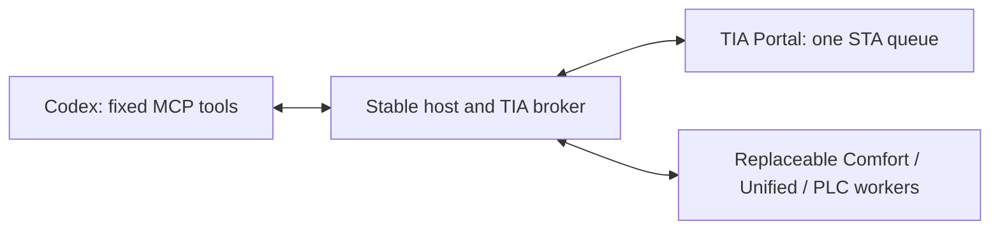

# Reloadable feature extensions — 0.7.0

The MCP host retains its connection to Codex and owns the Siemens attachment, single STA queue, transactions, offline checks, preview stores, candidate hashes and native readback. Pure feature workers receive JSON snapshots, never Siemens CLR objects. The host copies complete, hash-checked bundles into private generation directories before starting workers, so they do not lock the source of the next update.

Existing Comfort XML scalar/behavior previews, classic/Unified text-list transformations, Unified caption/property previews and PLC source preparation use workers. Native browsing, transfers, compile, save and security policy remain in the broker. New native broker capabilities or Siemens API versions still require a host upgrade/reconnect.



## Chat commands

- `tia_list_extensions`: loaded versions, worker/host process IDs, generation IDs and operation input schemas.
- `tia_reload_extensions(module="comfort")`: replace one worker; empty module replaces all configured modules atomically.
- `tia_read_extension`: run an advertised local inspection with `argumentsJson` matching its schema.
- `tia_preview_extension`: prepare an advertised operation against an explicit native target/snapshot/fingerprint.
- `tia_apply_extension_plan`: apply the authorized plan/hash through the broker; compile/save remain separate.

Dedicated HMI/PLC tools remain available. New operations appear in the extension catalog and use the same five facade tools, so Codex need not discover new MCP tool names. Its existing connection stays open.

Reload uses the native engineering queue and waits for active operations to finish. All replacements must pass file-integrity checks, protocol negotiation and worker startup/self-tests before activation. Successful reload invalidates **all** outstanding previews, including those from dedicated tools. Re-read and preview afterward. Rejected replacements retain the old workers and previews. Reload never detaches, saves, discards changes or reopens the project. Crashed or timed-out pure workers require reload; the host never replays a native write automatically. Replies have a 30-second deadline and 32 MiB frame limit.

## Stage an update

The default external root is `%LOCALAPPDATA%\SiemensTiaOpenness\Extensions`; `--extensions-root=<absolute-path>` selects another. A module selected in external `active.json` overrides its bundled version. Staging does not activate a new version in running hosts: reload explicitly. Each chat's host reloads independently.

Install a supplied, trusted extracted module bundle with the packaged script:

```powershell
powershell.exe -NoProfile -File 'C:\path\to\plugin\scripts\Install-Extension.ps1' `
  -BundleDirectory 'C:\path\to\comfort-bundle' `
  -ExpectedManifestSha256 '<verified extension.json SHA-256>'
```

The script verifies exact members, lengths/hashes, paths and protocol metadata; rejects linked paths and Siemens engineering DLLs; copies to a new version directory; then atomically updates `active.json`. The previous selection is retained as `active.previous.json`. It does not contact TIA or change Codex settings. A worker can still fail its startup checks; the running host keeps its previous worker. Restore the previous registry selection to abandon a rejected update.

For development, rebuild only the worker and stage the selected module:

```powershell
powershell.exe -NoProfile -File build\Build-Extensions.ps1 `
  -Destination "$env:LOCALAPPDATA\SiemensTiaOpenness\Extensions" `
  -WorkerVersion '0.7.1' -Modules comfort
```

Then call `tia_reload_extensions(module="comfort")`. This does not rebuild or replace the host. Use an isolated destination and matching host `--extensions-root` for test versions. Normal MCP builds automatically build bundled workers; `build\Build-Plugin.ps1` creates a complete release package with fresh bundled generations.

## Bundle and worker contract

A bundle contains `extension.json`, `SiemensTiaOpenness.ExtensionWorker.exe`, dependencies and optional feature data. The manifest is `tia-extension-v1`, protocol `1`, with a module name, three-part version and exact relative file inventory (`path`, `bytes`, `sha256`). Its handshake must return the same module/version/protocol and a bounded operation catalog. Workers include no Siemens engineering DLLs.

UTF-8 JSON-line requests contain `id`, `operation`, `input`; responses return the same `id` and `result` or `error`. `$hello` advertises operations. Supported routes are local inspection, internal transformations for existing tools, classic XML, Unified objects and PLC sources. The host controls native target selection and mutation scope. New routes require a host update; new operations on existing routes do not.

Comfort supports optional `recipes.json` presets covered by the bundle manifest and loaded at startup. This example adds an operation without changing host code:

```json
[
  {
    "name": "set_editor_grid",
    "description": "Apply the reviewed editor grid color",
    "xPath": "/Document[1]/Hmi.Screen.Screen[1]/AttributeList[1]/GridColor[1]",
    "newValue": "1, 2, 3"
  }
]
```

The recipe requires exact `expectedValue` arguments plus the selected resource fingerprint. Scalar-edit policy still protects IDs, resource names, slide-in edges and structural containers. The preview retains resolved edits and candidate XML. Recipes cannot execute code or scripts or call Siemens directly.

Extensions are trusted executable code running under the user's Windows account. Hashes provide content integrity, not publisher authentication or an OS sandbox. Arbitrary untrusted executables are outside this design.

## Initial migration and validation

A 0.6.x installation first needs the 0.7.0 host and five new tools. An already loaded 0.6.x executable cannot gain the loader through a worker update. Windows can keep the old cache locked until its processes close. This initial host installation is separate from subsequent worker reloads; package/manifest/skill changes are not guaranteed to load in place in Codex.

Pure tests and the persistent-STDIO upgrade test cover same-host 0.7.0-to-0.7.1 worker replacement, a new operation, Unicode, rejected-update rollback, payload tampering, crash/deadline recovery and worker shutdown. A selected native Comfort V15.1 trial also passed attached-project upgrade, stale-preview rejection, a new operation's edit/readback, unsaved-change preservation during another module's reload, restoration and compile/save/reopen. See `NATIVE-ACCEPTANCE.md` and delivery evidence for the exact binary/native scope. Unified and PLC native writes remain separate acceptance gaps.
