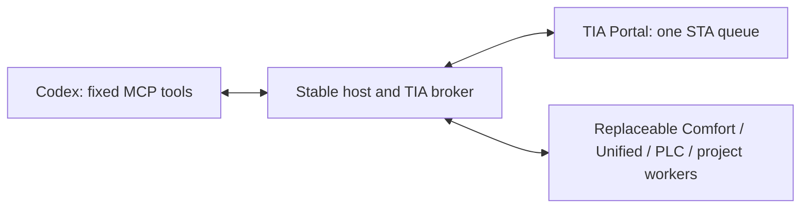

# Reloadable feature extensions — 0.8.0

The MCP host retains its connection to Codex and owns the Siemens attachment, single STA queue, transactions, offline checks, preview stores, candidate hashes and native readback. Pure feature workers receive JSON snapshots, never Siemens CLR objects. The host copies complete, hash-checked bundles into private generation directories before starting workers, so they do not lock the source of the next update.

Existing Comfort XML scalar/behavior previews, classic/Unified text-list transformations, Unified caption/property previews and PLC source preparation use workers. Native browsing, transfers, compile, save and security policy remain in the broker. New native broker capabilities or Siemens API versions still require a host upgrade/reconnect.



## Chat commands

- `tia_list_extensions`: loaded versions, worker/host process IDs, generation IDs and operation input schemas.
- `tia_reload_extensions(module="comfort")`: replace one worker; empty module replaces all configured modules atomically.
- `tia_read_extension`: run an advertised local, PLC or project snapshot inspection with `argumentsJson` matching its schema. PLC capture requires an attachment, explicit PLC/object paths and verified Offline state; source export writes local artifacts. Project library capture requires the exact attached-project path and inspects only project/already-open global library metadata.
- `tia_preview_extension`: prepare an advertised operation against an explicit native target/snapshot/fingerprint.
- `tia_apply_extension_plan`: apply the authorized plan/hash through the broker; compile/save remain separate.

Dedicated HMI/PLC tools remain available. New operations appear in the extension catalog and use the same five facade tools, so Codex need not discover new MCP tool names. Its existing connection stays open.

Worker 0.7.2 adds Comfort `build_screen_package` and `validate_package_bindings` as local operations on the existing 0.7.1 host. They consume supplied native XML and PLC declarations without an attachment. See [Comfort packages](COMFORT-PACKAGES.md) for generation, reviewed file materialization and native import steps.

The 0.7.2 host also adds Unified owning-device compile-service lookup and reports its native scope. That change is broker code and requires a host upgrade/reconnect. It cannot be delivered by worker reload.

The 0.7.3 host adds the `plcRead` snapshot route for [readable-source export/search and cross-references](PLC-INSPECTION.md). It requires a host upgrade/reconnect; older hosts reject the route and keep the previous worker. Subsequent worker operations can format/search these same native snapshot kinds without another broker change.

The 0.7.4 host changes API loading, project graphics access and older Unified screen discovery. Those native adapters require a host upgrade/reconnect. The worker protocol and existing routes are unchanged; see [API compatibility](API-COMPATIBILITY.md).

The 0.8.0 host adds `projectRead` and a fourth bundled `project` module for [library inspection](LIBRARY-INSPECTION.md). Upgrade/reconnect the host before installing that module; pre-0.8.0 hosts reject its route. Existing routes are unchanged; the newer PLC worker was checked on a 0.7.4 host. Discovery/reload-all includes module names from both bundled and external registries. Future project worker operations may format the same bounded library snapshot without another native route.

Reload uses the native engineering queue and waits for active operations to finish. All replacements must pass file-integrity checks, protocol negotiation and worker startup/self-tests before activation. Successful reload invalidates **all** outstanding previews, including those from dedicated tools. Re-read and preview afterward. Rejected replacements retain the old workers and previews. Reload never detaches, saves, discards changes or reopens the project. Crashed or timed-out pure workers require reload; the host never replays a native write automatically. Replies have a 30-second deadline and 32 MiB frame limit.

## Stage an update

The default external root is `%LOCALAPPDATA%\SiemensMCPServer\Extensions`; `--extensions-root=<absolute-path>` selects another. When that directory does not yet exist and `%LOCALAPPDATA%\SiemensTiaOpenness\Extensions\active.json` exists, the host and extension installer retain that legacy root. Creating the new root selects it on the next host start; old data is never moved or deleted. Explicit roots always take precedence. A module selected in external `active.json` overrides its bundled version. Staging does not activate a new version in running hosts: reload explicitly. Each chat's host reloads independently.

Install a supplied, trusted extracted module bundle with the packaged script:

```powershell
powershell.exe -NoProfile -File 'C:\path\to\plugin\scripts\Install-Extension.ps1' `
  -BundleDirectory 'C:\path\to\comfort-bundle' `
  -ExpectedManifestSha256 '<verified extension.json SHA-256>'
```

The script verifies exact members, lengths/hashes, paths and protocol metadata; rejects linked paths and Siemens engineering DLLs; copies to a new version directory; then atomically updates `active.json`. The previous selection is retained as `active.previous.json`. It does not contact TIA or change Codex settings. A worker can still fail its startup checks; the running host keeps its previous worker. Restore the previous registry selection to abandon a rejected update.

For development, rebuild only the worker and stage the selected module:

```powershell
powershell.exe -NoProfile -File build\Build-Extensions.ps1 `
  -Destination "$env:LOCALAPPDATA\SiemensMCPServer\Extensions" `
  -WorkerVersion '0.7.2' -Modules comfort
```

Then call `tia_reload_extensions(module="comfort")`. This does not rebuild or replace the host. Use an isolated destination and matching host `--extensions-root` for test versions. Normal MCP builds automatically build bundled workers; `build\Build-Plugin.ps1` creates a complete release package with fresh bundled generations.

## Bundle and worker contract

A bundle contains `extension.json`, `SiemensMCPServer.ExtensionWorker.exe`, dependencies and optional feature data. The host and installer also accept the former `SiemensTiaOpenness.ExtensionWorker.exe` entry point for existing protocol-1 bundles, with the same integrity and handshake checks. The manifest is `tia-extension-v1`, protocol `1`, with a module name, three-part version and exact relative file inventory (`path`, `bytes`, `sha256`). Its handshake must return the same module/version/protocol and a bounded operation catalog. Workers include no Siemens engineering DLLs.

UTF-8 JSON-line requests contain `id`, `operation`, `input`; responses return the same `id` and `result` or `error`. `$hello` advertises operations. Supported routes are local inspection, internal transformations for existing tools, classic XML, Unified objects, PLC sources, PLC read snapshots and project read snapshots. The host controls native target selection and mutation scope. New routes require a host update; new operations on existing routes do not.

`plcRead` operations must belong to module `plc`, set `preview=false` and declare `snapshotKind="source"` or `"crossReferences"`. Caller arguments contain exact `plcId`/`path`, host-validated `capture`, and worker-specific `options`. The host calls the worker with `phase="validate"` before capture, then with `phase="snapshot"` and the serialized native snapshot. The worker must support both phases. Capture settings come from the caller and are never taken from worker output. The route cannot import, generate blocks, compile, save or navigate native services beyond the two declared read capabilities. Workers normalize one optional UTF-8 BOM at the first input frame; JSON content is preserved. Failed worker starts retain bounded stderr diagnostics and the previous generation.

`projectRead` operations must belong to module `project`, set `preview=false` and declare `snapshotKind="libraryCatalog"`. Arguments contain exact `expectedProjectPath`, host-validated `capture` (`libraryId`, `path`, `offset`, `maxRows`) and worker-specific `options`. Empty `libraryId` lists libraries; a returned ID selects a library/path. The same validate/capture/snapshot sequence applies. The broker restricts capture to documented metadata compositions and scalar fields; it does not open/upgrade/save libraries, instantiate contents, traverse dependencies or expose native handles. Client-supplied snapshot fields are rejected. Reads do not require `--allow-writes`.

Comfort supports optional `recipes.json` presets covered by the bundle manifest and loaded at startup. This example adds an operation without changing host code:

```json
[
  {
    "name": "set_editor_grid",
    "description": "Apply the reviewed editor grid color",
    "xPath": "/Document[1]/Hmi.Screen.Screen[1]/AttributeList[1]/GridColor[1]",
    "newValue": "1, 2, 3"
  }
]
```

The recipe requires exact `expectedValue` arguments plus the selected resource fingerprint. Scalar-edit policy still protects IDs, resource names, slide-in edges and structural containers. The preview retains resolved edits and candidate XML. Recipes cannot execute code or scripts or call Siemens directly.

Extensions are trusted executable code running under the user's Windows account. Hashes provide content integrity, not publisher authentication or an OS sandbox. Arbitrary untrusted executables are outside this design.

## Initial migration and validation

A 0.6.x installation first needs the 0.7.0 host and five new tools. An already loaded 0.6.x executable cannot gain the loader through a worker update. Windows can keep the old cache locked until its processes close. This initial host installation is separate from subsequent worker reloads; package/manifest/skill changes are not guaranteed to load in place in Codex.

Pure tests and the persistent-STDIO upgrade test cover worker replacement, a new operation, Unicode, rejected-update rollback, payload tampering, crash/deadline recovery and shutdown. See [validation status](NATIVE-ACCEPTANCE.md) for native-check scope. Unified and PLC native writes require separate acceptance. Keep raw evidence outside the public repository or under `.local/`.
